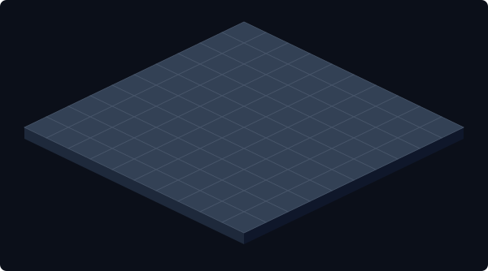

# ⚔️ Git Mine Empires: Battlegrounds (Isometric 3D)

> ⏱️ Current Turn: **@arjunagarwal1311-del** | [🔄 **Reset Board**](https://github.com/arjunagarwal1311-del/octo-minesweeper/issues/new?title=reset&amp;body=Click+Submit+New+Issue+to+reset+the+game+board.)

### 🏆 Empire Territories
| Player | Type | Empire Color | Territory Size | Status |
| :--- | :--- | :--- | :--- | :--- |
| @arjunagarwal1311-del | HUMAN | `blue` | 0 Blocks | 🟢 Active |
| @user2 | HUMAN | `red` | 0 Blocks | 🟢 Active |
| @BotAlpha | BOT | `green` | 0 Blocks | 🟢 Active |
| @BotBeta | BOT | `purple` | 0 Blocks | 🟢 Active |

### 🗺️ Isometric Battleground (Click tile to Conquer)

### 📜 Recent Conquest Log
- 🎮 Game initialized! @user1's turn to move.